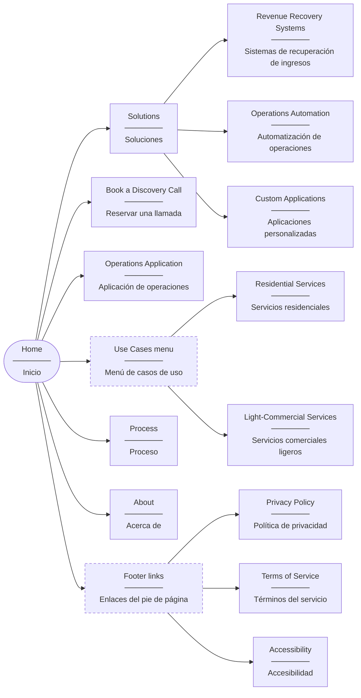

# LamaByte Systems

**I designed, built and launched the English and Spanish website for my company, LamaByte Systems, including its interactive operations application.**

[Visit lamabyte.systems](https://lamabyte.systems/) · [Try the operations application](https://lamabyte.systems/operations-application) · [Ver la aplicación en español](https://lamabyte.systems/es/aplicacion-de-operaciones)

I'm Arturo E. Lamas, the founder of LamaByte Systems. The site presents the company's services to residential and light-commercial service businesses in both languages. Before booking a discovery call, visitors can try five guided office workflows in the interactive application.

| At a glance     |                                                                                                                                                                      |
| --------------- | -------------------------------------------------------------------------------------------------------------------------------------------------------------------- |
| **Pages**       | 28 indexable pages, 14 in each language, plus a 404 page in each language                                                                                            |
| **Application** | Five guided scenarios on illustrative sample records, running entirely in the browser                                                                                |
| **Lighthouse**  | Local lab audit with one run per page and the hero fallback. Performance was 96–100 on mobile and 100 on desktop. Accessibility and SEO scored 100 in both profiles. |
| **Tests**       | The November 2026 maintenance release passed 1,411 unit tests, 800 browser regression tests and 299 selected live-site checks.                                       |
| **Stack**       | Astro, React, TypeScript, Tailwind CSS and Motion, with Three.js in the hero animation                                                                               |

## What I did

- **Website.** I designed the site structure, responsive layouts and paired English and Spanish routes, with language switching across the site. I built the path from exploring services to booking a discovery call, and I reviewed and approved all 914 Spanish text units before they went live.
- **Interactive application.** I designed five guided scenarios covering estimate recovery, missed-call recovery, maintenance-plan renewal, administrative automation and light-commercial proposal follow-up. Visitors click through each workflow, watch the sample records change, and can reset to the start at any time.
- **Design and motion.** I shaped the look and feel across the site with scroll reveals, typewriter headings and hover transitions. I created the 3D llama meadow separately and integrated it into the homepage hero. I extended the floating llama and its glow to touch screens, then tested them on my phone.
- **Release.** I tested the site in real browsers on Windows, ran the live-site checks from my own PC, published each version through Cloudflare, and confirmed the booking calendar and touch effects on the live site.

## Site map

Each box shows the English page name above its Spanish counterpart. Dashed boxes group the Use Cases menu and footer links. Unknown addresses return the Page Not Found page in the matching language.

### Page links

| English                                                                                   | Español                                                                                                 |
| ----------------------------------------------------------------------------------------- | ------------------------------------------------------------------------------------------------------- |
| [Home](https://lamabyte.systems/)                                                         | [Inicio](https://lamabyte.systems/es/)                                                                  |
| [Solutions](https://lamabyte.systems/solutions)                                           | [Soluciones](https://lamabyte.systems/es/soluciones)                                                    |
| [Revenue Recovery Systems](https://lamabyte.systems/solutions/revenue-recovery)           | [Sistemas de recuperación de ingresos](https://lamabyte.systems/es/soluciones/recuperacion-de-ingresos) |
| [Operations Automation](https://lamabyte.systems/solutions/operations-automation)         | [Automatización de operaciones](https://lamabyte.systems/es/soluciones/automatizacion-de-operaciones)   |
| [Custom Applications](https://lamabyte.systems/solutions/custom-applications)             | [Aplicaciones personalizadas](https://lamabyte.systems/es/soluciones/aplicaciones-personalizadas)       |
| [Operations Application](https://lamabyte.systems/operations-application)                 | [Aplicación de operaciones](https://lamabyte.systems/es/aplicacion-de-operaciones)                      |
| [Residential Services](https://lamabyte.systems/use-cases/residential-services)           | [Servicios residenciales](https://lamabyte.systems/es/casos-de-uso/servicios-residenciales)             |
| [Light-Commercial Services](https://lamabyte.systems/use-cases/light-commercial-services) | [Servicios comerciales ligeros](https://lamabyte.systems/es/casos-de-uso/servicios-comerciales-ligeros) |
| [Process](https://lamabyte.systems/process)                                               | [Proceso](https://lamabyte.systems/es/proceso)                                                          |
| [About](https://lamabyte.systems/about)                                                   | [Acerca de](https://lamabyte.systems/es/acerca)                                                         |
| [Book a Discovery Call](https://lamabyte.systems/book)                                    | [Reservar una llamada](https://lamabyte.systems/es/reservar)                                            |
| [Privacy Policy](https://lamabyte.systems/privacy)                                        | [Política de privacidad](https://lamabyte.systems/es/privacidad)                                        |
| [Terms of Service](https://lamabyte.systems/terms)                                        | [Términos del servicio](https://lamabyte.systems/es/terminos)                                           |
| [Accessibility](https://lamabyte.systems/accessibility)                                   | [Accesibilidad](https://lamabyte.systems/es/accesibilidad)                                              |
| [Page Not Found (404)](https://lamabyte.systems/404.html)                                 | [Página no encontrada (404)](https://lamabyte.systems/es/404.html)                                      |

## Engineering choices

- **Static pages first.** I used Astro to generate every English and Spanish page as static HTML, so the content appears before any application code runs.
- **The application loads when needed.** I made the interactive application a React component that loads only as a visitor scrolls near it, which keeps the rest of the site fast. Typed scenario data and state transitions give each walkthrough a predictable start and reset.
- **Motion that respects the visitor.** The 3D meadow runs only on devices with hardware graphics support, and only after the page has loaded. I gave it a pause control, and visitors who prefer reduced motion see a still frame. Keyboard navigation and visible focus work across the site, and the touch effects leave normal scrolling and zooming intact.
- **Booking on demand.** The scheduling calendar loads inline on the booking page or opens in a popup from a booking button. The site also provides a direct booking link.

## Quality and performance

The November 25, 2026 Lighthouse audits used one run per page and device profile on a locally served build. With WebGL disabled, the lab used the plain hero background. Analytics and error reporting were also disabled. [Mobile results](ENGINEERING.md#mobile-lighthouse-results) · [Desktop results](ENGINEERING.md#desktop-lighthouse-results)

The cloud run and focused browser reruns covered 774 cases, and 26 passed on my Windows PC. The live-site suite passed on its final run after a rollback and retry. [Release verification](ENGINEERING.md#release-verification)

The [engineering notes](ENGINEERING.md) cover code examples, the reasoning behind the design and the full test results.
